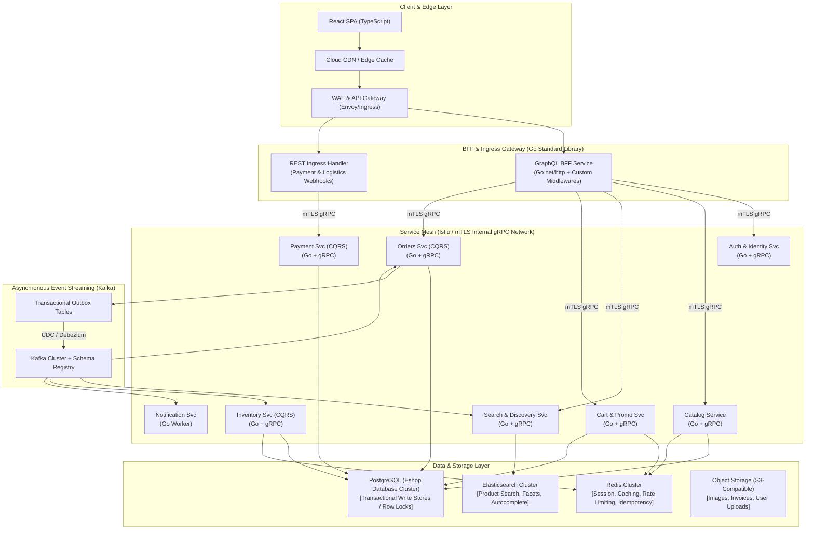

# StyleHome E-Commerce Platform — Enterprise Architecture Blueprint
**Database Name**: `Eshop`  
**Application Name**: `StyleHome`  
**Architecture Style**: Event-Driven Microservices + CQRS + Domain-Driven Design (DDD)  
**Backend Runtime**: Go (Standard Library `net/http` + gRPC + Protobuf, Zero Frameworks)  
**Frontend**: React SPA (TypeScript + React Query + React Router + Context/Redux)

---

## 1. Executive Architecture Summary

**StyleHome** is an enterprise-scale modern e-commerce platform designed to support millions of concurrent users, high-velocity flash sales, and low-latency worldwide catalog discovery.



---

## 2. Technology Selection & Architectural Rationale

### 2.1 Go Standard Library (`net/http`) Without Third-Party Frameworks
* **Why**: Avoids framework churn, reduces memory allocations per request (crucial for 100k+ req/sec), minimizes binary sizes, and ensures long-term maintainability.
* **Implementation**: Uses standard `http.Handler` / `http.HandlerFunc`, `http.ServeMux` (or Go 1.22+ enhanced pattern routing), and layered composable middleware closures `func(http.Handler) http.Handler` for Auth, Tracing, Metrics, Rate Limiting, and CORS.

### 2.2 gRPC for Internal Microservice Communication
* **Why**: High-performance HTTP/2 binary protocol using Protocol Buffers v3. Offers multiplexing, header compression, strict interface definition language (IDL), and code generation.
* **Benefit**: Reduces inter-service latency to sub-millisecond ranges while eliminating JSON serialization overhead during synchronous stock reservation and payment checks.

### 2.3 GraphQL as the Frontend BFF (Backend-For-Frontend)
* **Why**: Eliminates over-fetching and under-fetching on mobile and desktop web clients. Allows the React SPA to request exactly the attributes needed for a screen in a single HTTP request.
* **Benefit**: Schema-first design (SDL) with query depth analysis, complexity limiting, and dataloader batching to eliminate N+1 query problems.

### 2.4 CQRS (Command Query Responsibility Segregation)
* **Write Path (Commands)**: Handles transactions, business validations, invariants, and state transitions using PostgreSQL with row-level locks and ACID guarantees (`Eshop` schema-per-service). Appends domain events to a local `outbox` table within the same ACID transaction.
* **Read Path (Queries)**: Optimized materialized views, Redis caches, and Elasticsearch indices populated asynchronously via Kafka event streams. Reads do not block transactional tables.

### 2.5 Elasticsearch for Search & Discovery
* **Why**: Inverted index, custom edge-ngram tokenizers for autocomplete, BM25 relevance scoring, and faceted aggregations across millions of SKU variations.
* **Benefit**: Sub-10ms response times for complex multi-filter navigation queries (e.g., category + price range + brand + rating + in-stock status).

### 2.6 Apache Kafka & Transactional Outbox Pattern
* **Why**: Decouples write operations from long-running side effects (emails, search index updates, notifications, cross-domain state sync).
* **Guarantees**: At-least-once delivery with idempotent consumers. The Transactional Outbox pattern guarantees that a domain event is published if and only if the database transaction commits successfully.

---

## 3. Database Architecture (`Eshop` Database)

The database engine is PostgreSQL. Microservices maintain bounded context isolation using dedicated schemas within the `Eshop` database (or dedicated databases in high-tier multi-region setups):

```
Eshop (PostgreSQL Database)
├── auth_schema
│   ├── users
│   ├── roles_permissions
│   ├── refresh_tokens
│   └── federated_identities
├── catalog_schema
│   ├── products
│   ├── product_variants
│   ├── categories
│   ├── attributes
│   └── product_images
├── inventory_schema
│   ├── warehouse_stock
│   ├── inventory_reservations
│   └── stock_ledger
├── cart_schema
│   ├── carts
│   └── cart_items
├── order_schema
│   ├── orders
│   ├── order_items
│   ├── order_status_history
│   └── outbox_events
└── payment_schema
    ├── payment_transactions
    ├── payment_methods_tokenized
    └── outbox_events
```

---

## 4. Security Framework (OWASP ASVS Level 3 Compliant)

1. **Authentication**: OAuth 2.0 / OIDC with RS256 JWT access tokens (TTL: 15 minutes) and rotated refresh tokens stored in Redis with revocation blacklist support.
2. **Zero Trust Transport**: Mutual TLS (mTLS) via Istio Service Mesh across all inter-service gRPC communication.
3. **Financial & PII Protection**: Strict PCI-DSS compliance by avoiding raw card storage. All payment methods are tokenized via external provider SDKs (Stripe / Adyen). Sensitive PII encrypted at rest using AES-256-GCM with AWS KMS / HashiCorp Vault.
4. **Application Hardening**:
   - Parameterized SQL queries (zero string concatenation).
   - Strict Content Security Policy (CSP), CORS allowlist, SameSite cookies.
   - GraphQL Query Complexity and Depth limiting (Max depth: 7).
   - Distributed Token Bucket Rate Limiting in Redis.
