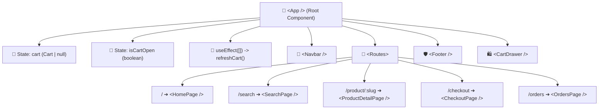

# <span style="color:#e2b170;">React Fundamentals & Hooks Guide</span>

> <span style="color:#94a3b8;">StyleHome E-Shop Documentation & Architecture</span>

---

## 📖 <span style="color:#f59e0b;">CHAPTER 1: `main.tsx` — Complete Architectural Breakdown</span>

**Source File:** [`frontend/src/main.tsx`](file:///c:/Users/Rehna/Downloads/Go-lab/Eshop/frontend/src/main.tsx) (12 Lines)

| Line Number in `main.tsx` | Code Statement | Breakdown Point |
| :--- | :--- | :--- |
| **Line 1** | `import React from 'react';` | [**Point 1: Core APIs & StrictMode**](#-1-what-does-import-react-from-react-mean) |
| **Line 2** | `//COMPONETS,HOOKS,JSX` | [**Point 2: What Are Hooks? (Mental Model)**](#-2-what-are-hooks-in-react) |
| **Line 3** | `//Hooks = Functions that let functional...` | [**Point 3: The 2 Golden Rules of Hooks**](#-3-the-2-golden-rules-of-hooks) |
| **Line 4** | `import ReactDOM from 'react-dom/client';` | [**Point 4: The Builder Bridge**](#-4-what-does-import-reactdom-from-react-domclient-do) |
| **Line 5** | `import { App } from './app/App';` | [**Point 5: The Master Castle Story**](#-5-what-does-import--app--from-appapp-mean) |
| **Line 6** | `import './index.css';` | [**Point 6: The Royal Tailor & Global CSS**](#-6-what-does-import-indexcss-do) |
| **Lines 8–12** | `ReactDOM.createRoot(...).render(...)` | [**Point 7: The Grand Launchpad**](#-7-the-grand-launchpad-reactdomcreaterootrender) |

---

## 🟡 <span style="color:#e2b170;">1. What Does `import React from 'react';` Mean?</span>

**File Location:** [`frontend/src/main.tsx`](file:///c:/Users/Rehna/Downloads/Go-lab/Eshop/frontend/src/main.tsx#L1)

```tsx
import React from 'react';
```

### Key Functions:

- <span style="color:#38bdf8; font-weight:600;">Core Component Access:</span> Grants access to top-level APIs such as `<React.StrictMode>`.
  - `<React.StrictMode>` activates development-only checks, warnings, and double-rendering to detect side-effect bugs early.
- <span style="color:#a855f7; font-weight:600;">Built-in Hooks:</span> Allows calling `React.useState`, `React.useEffect`, `React.useRef`, etc.
- <span style="color:#10b981; font-weight:600;">TypeScript Typing:</span> Exposes types like `React.FC` (Functional Component), `React.ReactNode`, and `React.CSSProperties`.
- <span style="color:#f59e0b; font-weight:600;">Modern JSX Transformation:</span> While React 17+ compiles plain JSX without this import, referencing the `React` namespace directly still requires `import React from 'react'`.

---

## 🟢 <span style="color:#10b981;">2. What Are Hooks in React?</span>

**Hooks** are special functions that allow you to *"hook into"* React state and lifecycle features from inside functional components.

> <span style="color:#e2b170; font-weight:bold;">Naming Convention:</span> All hook names always begin with the prefix **`use`** (e.g., `useState`, `useEffect`).

### <span style="color:#38bdf8;">Essential Built-in Hooks</span>

| Hook | Type / Purpose | Example from Your App |
| :--- | :--- | :--- |
| <span style="color:#e2b170; font-weight:bold;">`useState`</span> | <span style="color:#94a3b8;">Local state management</span> | [`const [cart, setCart] = useState<Cart \| null>(null);`](file:///c:/Users/Rehna/Downloads/Go-lab/Eshop/frontend/src/app/App.tsx#L14) |
| <span style="color:#10b981; font-weight:bold;">`useEffect`</span> | <span style="color:#94a3b8;">Side effects & data fetching</span> | [`useEffect(() => { refreshCart(); }, []);`](file:///c:/Users/Rehna/Downloads/Go-lab/Eshop/frontend/src/app/App.tsx#L26-L28) |
| <span style="color:#f43f5e; font-weight:bold;">`useContext`</span> | <span style="color:#94a3b8;">Global state without prop drilling</span> | Accessing user auth, theme, or cart across deeply nested components |
| <span style="color:#a855f7; font-weight:bold;">`useRef`</span> | <span style="color:#94a3b8;">Mutable reference / DOM node access</span> | Focusing an input or preserving timer IDs across re-renders |
| <span style="color:#06b6d4; font-weight:bold;">`useMemo`</span> | <span style="color:#94a3b8;">Expensive calculation caching</span> | Memoizing filtered product lists or pricing calculations |
| <span style="color:#ec4899; font-weight:bold;">`useCallback`</span> | <span style="color:#94a3b8;">Function reference caching</span> | Passing stable callback handlers to child components |

---

### <span style="color:#e2b170;">Code Example: `useState` & `useEffect`</span>

From [frontend/src/app/App.tsx](file:///c:/Users/Rehna/Downloads/Go-lab/Eshop/frontend/src/app/App.tsx#L14-L28):

```tsx
// 1. Declare state variables
const [cart, setCart] = useState<Cart | null>(null);
const [isCartOpen, setIsCartOpen] = useState<boolean>(false);

// 2. Fetch data once on initial load (mounting)
useEffect(() => {
  refreshCart();
}, []); // Empty dependency array means: run once on mount
```

---

## 🔴 <span style="color:#f43f5e;">3. The 2 Golden Rules of Hooks</span>

### ⛔ <span style="color:#f43f5e; font-weight:bold;">Rule 1: Only Call Hooks at the Top Level</span>
- **Never** call hooks inside loops (`for`, `while`), conditions (`if`/`else`), or nested functions.
- React relies on the exact order in which hooks are called across renders to maintain internal state integrity.

### ⛔ <span style="color:#f43f5e; font-weight:bold;">Rule 2: Only Call Hooks from React Functions</span>
- Call hooks from React **functional components**.
- Call hooks from **custom hooks** (functions named `useSomething`).
- Do **not** call hooks inside regular JavaScript utility functions.

---

## 🔵 <span style="color:#06b6d4;">4. What Does `import ReactDOM from 'react-dom/client';` Do?</span>

**File Location:** [`frontend/src/main.tsx`](file:///c:/Users/Rehna/Downloads/Go-lab/Eshop/frontend/src/main.tsx#L4)

```tsx
import ReactDOM from 'react-dom/client';

ReactDOM.createRoot(document.getElementById('root') as HTMLElement).render(
  <React.StrictMode>
    <App />
  </React.StrictMode>
);
```

### The Metaphor: The Architect vs. The Builder

- <span style="color:#f59e0b; font-weight:bold;">React = The Architect:</span> Designs components (`<App />`, `<Navbar />`), tracks state, and builds the Virtual DOM blueprint. It has no direct knowledge of web browsers or real HTML pixels.
- <span style="color:#06b6d4; font-weight:bold;">ReactDOM = The Builder & Painter:</span> The specialized bridge that takes React's virtual blueprint and physically builds real HTML DOM nodes (`<div id="root">`, `<h1>`, `<button>`) inside the browser window.

### Breakdown of the Code:

1. **`document.getElementById('root')`**: Locates the single HTML mount container `<div id="root"></div>` defined in `index.html`.
2. **`createRoot(...)`**: Initializes React 18's high-performance Concurrent Mode rendering engine.
3. **`.render(<App />)`**: Renders your entire component tree inside that container and keeps it live and reactive.

---

## 🟣 <span style="color:#a855f7;">5. What Does `import { App } from './app/App';` Mean?</span>

**File Location:** [`frontend/src/main.tsx`](file:///c:/Users/Rehna/Downloads/Go-lab/Eshop/frontend/src/main.tsx#L5)

```tsx
import { App } from './app/App';
```

### 📖 The Memorable Story: The Gatekeeper & The Master Castle

> Imagine your web application is an ancient kingdom:
>
> 1. **The City Gatekeeper (`main.tsx`):** Stands guard at the city gates (`<div id="root">`). He holds the magic construction tool (`ReactDOM`), but he has no idea how to design a castle.
> 2. **The Master Castle (`App.tsx`):** Built inside the royal atelier (`./app/App.tsx`). Inside this castle is the Watchtower (`<Navbar />`), the Grand Halls (`<HomePage />`, `<SearchPage />`), and the Treasure Vault (`<CartDrawer />`).
> 3. **The Delivery Order (`import { App } from './app/App';`):** The Gatekeeper calls the atelier: *"Deliver the Master Castle (`App`) to the front gates!"*
> 4. **The Grand Opening (`.render(<App />)`):** The Gatekeeper drops the Castle onto the foundation (`#root`). Instantly, the entire kingdom comes alive for visitors in their web browser!

### 🔑 Key Technical Details:

- <span style="color:#a855f7; font-weight:bold;">Named Import `{ App }`:</span> In `App.tsx`, the code writes `export const App = ...`. Because it is a named export, it must be imported with curly braces `{ App }`.
- <span style="color:#e2b170; font-weight:bold;">Relative Path `'./app/App'`:</span> `./` starts in `src/`, enters `app/`, and loads `App.tsx` (the `.tsx` extension is automatically inferred by Vite).
- <span style="color:#10b981; font-weight:bold;">Single Mother Ship:</span> `main.tsx` is just the ignition switch. `App.tsx` is the root component that houses state, routing, and all UI layouts.

---

## 🎨 <span style="color:#e2b170;">6. What Does `import './index.css';` Do?</span>

**File Location:** [`frontend/src/main.tsx`](file:///c:/Users/Rehna/Downloads/Go-lab/Eshop/frontend/src/main.tsx#L6)

```tsx
import './index.css';
```

### 👔 The Story of the Royal Tailor & The Naked Castle

> When the Master Castle (`<App />`) is constructed, it is completely naked:
>
> 1. **The Naked Skeleton:** Without styles, HTML looks like default 1995 web pages: blinding white background, harsh black text in Times New Roman, and blue underlined hyperlinks.
> 2. **Calling the Royal Tailor (`import './index.css';`):** The Gatekeeper calls the atelier's master tailor. The tailor drapes the castle in obsidian dark velvet (`--bg-primary: #0d0f12`), installs gold leaf trim (`--accent-gold: #e2b170`), and sets up modern typography (`Plus Jakarta Sans`).
> 3. **Side-Effect Import:** Because there is no variable name or `from` keyword, Vite injects this stylesheet globally into the document `<head>`, ensuring every component across the entire app wears the royal theme.

### 🔑 Key Technical Details:

- <span style="color:#e2b170; font-weight:bold;">Side-Effect Import:</span> Imports the file solely for its global execution side effect (injecting styles) without exporting JavaScript functions or objects.
- <span style="color:#06b6d4; font-weight:bold;">Design Tokens (`:root`):</span> Declares reusable CSS custom properties for dark luxury aesthetics.
- <span style="color:#10b981; font-weight:bold;">Cross-Browser Normalization:</span> Enforces `box-sizing: border-box`, removes default margins, and ensures the site renders identically on all devices.

---

## 🚀 <span style="color:#10b981;">7. The Grand Launchpad: `ReactDOM.createRoot(...).render(...)`</span>

**File Location:** [`frontend/src/main.tsx`](file:///c:/Users/Rehna/Downloads/Go-lab/Eshop/frontend/src/main.tsx#L8-L12)

```tsx
ReactDOM.createRoot(document.getElementById('root') as HTMLElement).render(
  <React.StrictMode>
    <App />
  </React.StrictMode>
);
```

### ⚡ The Story of the Foundation, Safety Inspector & Power Switch

> This 5-line block is the entire ignition sequence of the application:
>
> 1. **Finding the Land (`document.getElementById('root')`):** Searches `index.html` to find the empty mounting container `<div id="root"></div>`.
> 2. **The Deed Guarantee (`as HTMLElement`):** Assures TypeScript that this element definitely exists in the DOM and is not `null`.
> 3. **Pouring Concrete (`ReactDOM.createRoot(...)`):** Hands the empty container over to React 18, initializing Concurrent rendering and the Fiber state scheduler.
> 4. **The Safety Inspector (`<React.StrictMode>`):** A development watchdog that inspects your application before launch, intentionally running lifecycle methods and effects twice to catch bugs, memory leaks, and missing cleanups.
> 5. **Flipping the Master Switch (`.render(<App />)`):** Mounts the `<App />` component hierarchy and paints real reactive HTML elements to the browser!

### 🔑 Key Takeaways:

- <span style="color:#10b981; font-weight:bold;">React 18 Concurrent Root:</span> `createRoot()` replaces legacy `ReactDOM.render()`, unlocking automatic batching and interruptible rendering.
- <span style="color:#f43f5e; font-weight:bold;">StrictMode in Development:</span> If `console.log()` triggers twice, it is StrictMode verifying your code. It has zero overhead in production.
- <span style="color:#a855f7; font-weight:bold;">Application Entry Point:</span> This is the sole place where React meets the browser DOM. Everything else in your app branches out from `<App />`.

---

# 🏰 CHAPTER 2: `App.tsx` — Master Application Component Breakdown

> **Source File:** [`frontend/src/app/App.tsx`](file:///c:/Users/Rehna/Downloads/Go-lab/Eshop/frontend/src/app/App.tsx)  
> **Role:** The Central Nervous System & Mother Ship Component (86 Lines)

---

## 🗺️ Visual Architecture Map



---

## 🟡 Point 2.1: Line 1 — The Three Sorcerers of React
`import React, { useState, useEffect } from 'react';`

> ### 📖 The Story of the Three Sorcerers
> When assembling the royal palace of your app, one wizard is never enough. You summon three distinct sorcerers from the Realm of React:
> 1. **React (The Master Enchanter):** Casts the spell that turns plain JavaScript functions into interactive visual components.
> 2. **useState (The Memory Keeper):** Ordinary JavaScript variables vanish when a function finishes; the Memory Keeper writes values into an enchanted notebook so your cart and drawer toggles survive across renders!
> 3. **useEffect (The Time Traveler):** Sits in the watchtower. It waits for specific moments in time (like the store first opening) to trigger background sync duties.

```tsx
import React, { useState, useEffect } from 'react';
```

---

## 🔵 Point 2.2: Line 2 — The Grand Railway & Switch Tracks
`import { BrowserRouter, Routes, Route } from 'react-router-dom';`

> ### 📖 The Story of the Grand Railway
> In 1990s websites, clicking a product link destroyed the entire page and forced a blank white reload. `react-router-dom` brings the high-speed bullet railway:
> - **BrowserRouter (The Grand Station):** Monitors the browser URL address bar and history without page blinking.
> - **Routes (The Switch Operator):** Inspects incoming tickets and switches tracks.
> - **Route (The Platform):** Connects a specific URL path directly to a page component.

```tsx
import { BrowserRouter, Routes, Route } from 'react-router-dom';
```

---

## 🟣 Point 2.3: Lines 3–10 — The 8 Department Store Wings
`import { Navbar, Footer, CartDrawer, HomePage... } from '...';`

> ### 📖 The Story of the 8 Wings
> A luxury department store is divided into permanent architecture and dynamic halls:
> - **Permanent Architecture:**
>   - `<Navbar />`: The welcoming roof canopy with logo, nav links, and real-time cart item badge.
>   - `<Footer />`: The ground floor with trust badges, policies, and copyright.
>   - `<CartDrawer />`: The secret valet door hidden in the wall, sliding out whenever an item is added.
> - **Dynamic Halls:**
>   - `<HomePage />`: The glittering atrium with trending banners.
>   - `<SearchPage />`: The catalog library with instant filtering.
>   - `<ProductDetailPage />`: The artisan desk showing full specs and sizing.
>   - `<CheckoutPage />`: The cashier desk for payments and shipping addresses.
>   - `<OrdersPage />`: The customer delivery receipt bureau.

---

## 🟢 Point 2.4: Line 11 — The Diplomatic Courier to GraphQL
`import { api, Cart } from '../services/graphqlClient';`

> ### 📖 The Story of the Diplomatic Courier
> The React frontend runs in the customer's browser, while the databases and payment logic live in the Go backend microservice on port 8080:
> - **api (The Diplomatic Courier):** A pre-configured messenger with methods like `api.getCart()` and `api.addToCart()`. It packs requests into GraphQL queries and brings back JSON payloads.
> - **Cart (The Royal Treaty):** A TypeScript interface defining the exact contract of cart items, pricing totals, and discounts to prevent runtime bugs.

```tsx
import { api, Cart } from '../services/graphqlClient';
```

---

## 🟡 Point 2.5: Line 13 — Coronation of the Mother Ship
`export const App: React.FC = () => {`

> ### 📖 The Story of the Coronation
> This line crowns the component as Sovereign Ruler of the application:
> - `export`: Shares the component so `main.tsx` can mount it.
> - `const App`: Declares an immutable reference.
> - `React.FC`: Awards the royal title ("Functional Component" type in TypeScript).
> - `() => {`: Modern arrow function syntax holding all state and layouts.

---

## 🔵 Point 2.6: Lines 14–15 — The Two State Vaults
`const [cart, setCart] = useState<Cart | null>(null);`  
`const [isCartOpen, setIsCartOpen] = useState<boolean>(false);`

> ### 📖 The Story of the Two Vaults
> `<App />` safeguards two high-security vaults in its memory:
> 1. **Vault 1 (`cart, setCart`):** Stores items, quantities, and totals. Starts as `null` until fetched. Calling `setCart(newCart)` triggers instant UI updates across the app.
> 2. **Vault 2 (`isCartOpen, setIsCartOpen`):** A boolean toggle (`true` / `false`) controlling whether the cart drawer is visible or hidden.

---

## 🟢 Point 2.7: Lines 17–28 — The Morning Bell & Synchronization
`const refreshCart = async () => ... useEffect(() => { refreshCart(); }, []);`

> ### 📖 The Story of the Morning Bell
> When a customer enters the store, they might have existing items stored from an earlier session:
> - **`refreshCart()`:** Calls `await api.getCart()` and updates `setCart(c)`.
> - **`useEffect(..., [])`:** The empty dependency array `[]` commands React: *"Ring this morning bell exactly ONCE when the store first opens (initial component mount). Never ring it on normal re-renders!"*

```tsx
const refreshCart = async () => {
  try {
    const c = await api.getCart();
    setCart(c);
  } catch (err) {
    console.error('Failed to sync cart:', err);
  }
};

useEffect(() => {
  refreshCart();
}, []);
```

---

## 🔴 Point 2.8: Lines 30–56 — The Three Store Clerks
`handleAddToCart`, `handleUpdateQuantity`, `handleApplyCoupon`

> ### 📖 The Story of the Three Clerks
> Three specialized store clerks respond to customer interactions:
> 1. **Clerk 1 (`handleAddToCart`):** Sends the item to the Go backend, updates `setCart(updated)`, and automatically slides open the cart drawer (`setIsCartOpen(true)`) for instant visual confirmation.
> 2. **Clerk 2 (`handleUpdateQuantity`):** Adjusts item quantities (+ / - / delete) and keeps server tallies synchronized.
> 3. **Clerk 3 (`handleApplyCoupon`):** Validates discount codes against business rules. If invalid, catches the error safely and alerts the user (`alert('Invalid coupon')`).

```tsx
// Clerk 1: Add item and pop open drawer
const handleAddToCart = async (variantId: string, quantity: number = 1) => {
  const updated = await api.addToCart(variantId, quantity);
  setCart(updated);
  setIsCartOpen(true);
};

// Clerk 2: Update item quantity
const handleUpdateQuantity = async (cartItemId: string, quantity: number) => {
  const updated = await api.updateCartItem(cartItemId, quantity);
  setCart(updated);
};

// Clerk 3: Apply coupon
const handleApplyCoupon = async (code: string) => {
  try {
    const updated = await api.applyCoupon(code);
    setCart(updated);
  } catch (err: any) {
    alert(err.message || 'Invalid coupon');
  }
};
```

---

## 🟣 Point 2.9: Lines 58–85 — The Glass Skyscraper Skeleton
`<BrowserRouter><div style={{ minHeight: '100vh', ... }}>...</div></BrowserRouter>`

> ### 📖 The Story of the Glass Skyscraper
> The JSX blueprint creates an unbreakable, responsive architecture:
> - **Outer Shell (`minHeight: '100vh', display: 'flex'`):** Guarantees the layout fills 100% of the viewport height.
> - **`<main style={{ flex: 1 }}>`:** Expands to absorb all remaining space, firmly anchoring `<Footer />` at the bottom of short pages.
> - **`<Routes>`:** Swaps page components based on URL routes (`/`, `/search`, `/product/:slug`, `/checkout`, `/orders`).
> - **`<CartDrawer />`:** Mounted globally at the base of the tree so it can slide smoothly over any page.

```tsx
return (
  <BrowserRouter>
    <div style={{ display: 'flex', flexDirection: 'column', minHeight: '100vh' }}>
      <Navbar cart={cart} onOpenCart={() => setIsCartOpen(true)} />

      <main style={{ flex: 1 }}>
        <Routes>
          <Route path="/" element={<HomePage onAddToCart={handleAddToCart} />} />
          <Route path="/search" element={<SearchPage onAddToCart={handleAddToCart} />} />
          <Route path="/product/:slug" element={<ProductDetailPage onAddToCart={handleAddToCart} />} />
          <Route path="/checkout" element={<CheckoutPage cart={cart} onOrderSuccess={refreshCart} />} />
          <Route path="/orders" element={<OrdersPage />} />
        </Routes>
      </main>

      <Footer />

      <CartDrawer
        isOpen={isCartOpen}
        onClose={() => setIsCartOpen(false)}
        cart={cart}
        onUpdateQuantity={handleUpdateQuantity}
        onApplyCoupon={handleApplyCoupon}
      />
    </div>
  </BrowserRouter>
);
```

---
*StyleHome Architecture Documentation · E-Shop Full Stack Architecture*


